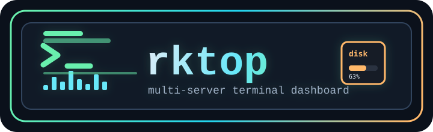
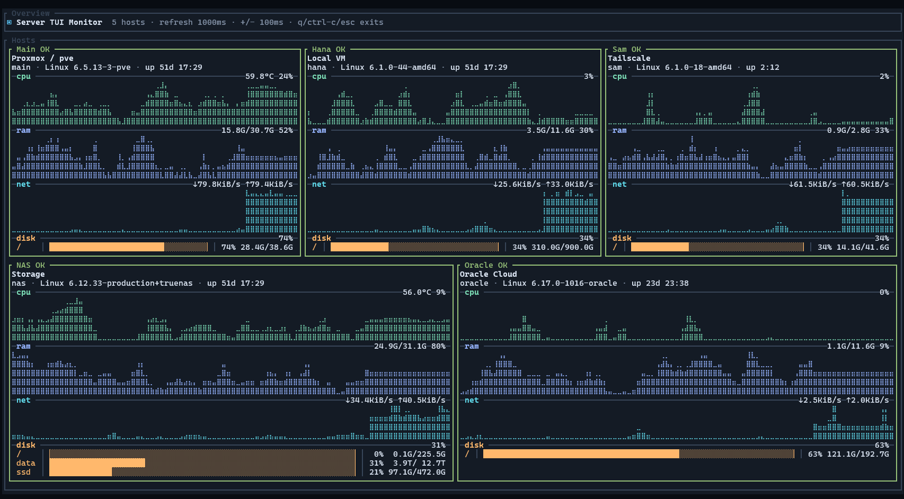
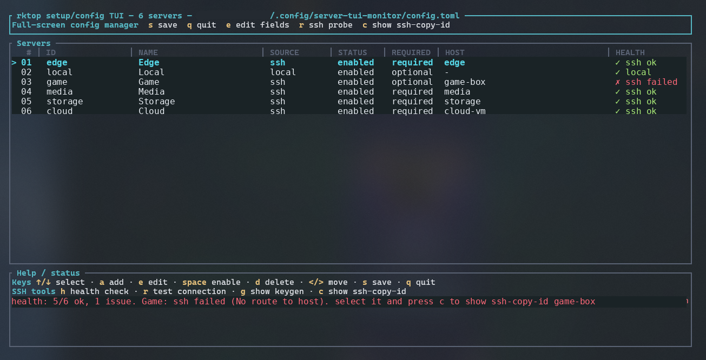

<div align="center">
  

  <p><strong>A btop-inspired TUI dashboard for monitoring multiple Linux servers over SSH.</strong></p>

  <p>
    
    
    
    
  </p>

  
</div>

## Overview

`rktop` is a live terminal dashboard for monitoring multiple Linux servers from one screen.
It runs locally, collects read-only metrics over SSH, and renders CPU, memory, network, disk, uptime, kernel, hostname, optional CPU temperature, and NVIDIA/AMD/Intel GPU metrics in btop-style cards.

- live by default: `rktop`
- no remote agent or remote install
- optional/offline hosts can be hidden
- btop-inspired braille graphs, bars, and aligned terminal layout
- multiple disks, ZFS pool summaries, aliases, and per-host disk row limits

The dashboard supports terminals as small as 40 columns × 24 rows. Narrow screens use a single host column and shorter disk bars and mount labels.

## Install

### Debian / Ubuntu (recommended)

```bash
wget https://github.com/Kinetic27/rktop/releases/download/v0.1.9/rktop_0.1.9_amd64.deb
sudo apt install ./rktop_0.1.9_amd64.deb
rktop config
rktop doctor
rktop
```

### Portable release

Use this when you want `rktop` and `config.toml` to stay in one extracted folder.

```bash
RKTOP_VERSION=v0.1.9
wget "https://github.com/Kinetic27/rktop/releases/download/${RKTOP_VERSION}/rktop_${RKTOP_VERSION#v}_linux_x86_64.tar.gz"
tar -xzf "rktop_${RKTOP_VERSION#v}_linux_x86_64.tar.gz"
cd rktop
./rktop config
./rktop doctor
./rktop
```

### macOS

Experimental: run `rktop` on macOS to monitor Linux SSH hosts. Local macOS metrics are not implemented yet.

```bash
RKTOP_VERSION=v0.1.9
wget "https://github.com/Kinetic27/rktop/releases/download/${RKTOP_VERSION}/rktop_${RKTOP_VERSION#v}_macos_x86_64.tar.gz"
tar -xzf "rktop_${RKTOP_VERSION#v}_macos_x86_64.tar.gz"
cd rktop
./rktop config
./rktop doctor
./rktop
```

### Windows

Portable zip:

```powershell
$Version = "v0.1.9"
Invoke-WebRequest "https://github.com/Kinetic27/rktop/releases/download/$Version/rktop_${Version}_windows_x86_64.zip" -OutFile rktop.zip
Expand-Archive .\rktop.zip -DestinationPath . -Force
cd .\rktop
.\rktop.exe config
.\rktop.exe doctor
.\rktop.exe
```

User PATH installer:

```powershell
powershell -ExecutionPolicy ByPass -c "irm https://raw.githubusercontent.com/Kinetic27/rktop/main/scripts/install.ps1 | iex"
```

Windows support is scoped to SSH monitoring: native `rktop.exe` can monitor Linux SSH hosts. Local Windows metrics are not implemented yet.

### Source build

```bash
git clone https://github.com/Kinetic27/rktop.git
cd rktop
scripts/install.sh
./.rktop/bin/rktop config
./.rktop/bin/rktop
```

Source install stays inside the clone under `./.rktop/`.

## Configuration

```bash
rktop config
```

`rktop config` opens the TUI config manager. It can add SSH hosts, add the local Linux machine, test SSH, show `ssh-copy-id` guidance, reorder hosts, mark hosts optional, and edit disk display options.

<p align="center">
  
</p>

Remote hosts need key-based SSH:

```bash
ssh -o BatchMode=yes user@host true
```

No remote writes, installs, or credential prompts are performed. SSH probes and metric collection have bounded timeouts, so broken SSH commands do not hang the app indefinitely.

Useful commands:

```bash
rktop doctor
rktop --live --snapshot
rktop edit
```

Config lookup order:

```text
--config PATH
$RKTOP_CONFIG
./config.toml beside the executable
~/.config/rktop/config.toml or $XDG_CONFIG_HOME/rktop/config.toml
/etc/rktop/config.toml on Linux
legacy ~/.config/server-tui-monitor/config.toml
```

Minimal config:

```toml
refresh_interval_ms = 1000

[[servers]]
id = "local"
name = "Local"
source = "local"

[[servers]]
id = "server-1"
name = "Server 1"
source = "ssh"
host = "server-1"
optional = false
```

## Support matrix

### Running rktop

| Environment | Status |
| --- | --- |
| Linux x86_64 | supported |
| Debian / Ubuntu | supported with `.deb` |
| Windows 10/11 | supported for monitoring Linux SSH hosts |
| macOS | experimental for monitoring Linux SSH hosts |

### Monitored hosts

| Target | Status |
| --- | --- |
| Linux over SSH | supported |
| Local Linux machine | supported |
| Proxmox host/VM over SSH | supported |
| Linux NAS / TrueNAS SCALE over SSH | supported when Linux shell access works |
| TrueNAS CORE / FreeBSD / BSD | not supported |
| Windows remote | not supported |

Remote Linux hosts should provide a POSIX shell, `/proc`, `df`, `awk`, `grep`, `hostname`, `uname`, and `base64` when monitored from Windows.

### GPUs

GPU monitoring is automatic for local Linux and Linux SSH hosts. Each detected GPU gets a utilization history graph, device name, VRAM used/total, and temperature when available. Multiple GPUs are tracked independently by NVIDIA UUID or PCI address, even when device order changes. If the model name is unavailable, AMD/Intel cards show their vendor and PCI device ID.

| Vendor | Collection requirements on the monitored host |
| --- | --- |
| NVIDIA | Working driver, `nvidia-smi`, and coreutils `timeout` in the collection user's `PATH`; queries time out after two seconds. |
| AMD | DRM sysfs (`amdgpu`): utilization, VRAM counters, and device hwmon temperature where exposed by the driver. No vendor tool required. |
| Intel | DRM sysfs for identification and available VRAM/temperature counters; optional `intel_gpu_top` and `timeout` for utilization. Intel utilization is the busiest engine class from a short 100ms sampling window, not a sum of concurrent engines. Perf counter access must be permitted for the collection user. |

No GPU software is installed, no permissions are changed, and no extra rktop configuration is required. Intel sampling stops after 0.4 seconds; timed commands have a one-second forced-kill grace period. Hosts without detected GPUs keep the existing CPU/RAM/NET/disk layout; missing tools or failed GPU queries do not prevent other metrics from being collected. Unsupported or inaccessible measurements display as `N/A`, not zero. In particular, integrated GPUs may not expose dedicated VRAM, and Intel utilization can be unavailable depending on the driver and perf permissions. GPU history contains only collected samples; missing utilization clears its graph until measurements resume.


## Refresh behavior

`refresh_interval_ms` is clamped to `100..60000`. In the TUI, `+`/`=` and `-` adjust it in 100ms steps. Unix-like machines running `rktop` use SSH `ControlMaster=auto` and `ControlPersist=10m` for faster repeated polling. Windows OpenSSH does not use those Unix socket multiplexing options. Optional hosts that fail are skipped briefly before retrying.

## Controls

| Key | Action |
| --- | --- |
| `q`, `Esc`, `Ctrl+C` | quit |
| `+`, `=` | faster refresh |
| `-` | slower refresh |

## Commands

```text
rktop [--mock|--live] [--snapshot] [--once] [--config PATH]
rktop init [--config PATH] [--force|--print]
rktop config [--config PATH]
rktop setup [--config PATH]
rktop edit [--config PATH]
rktop doctor [--config PATH]
```

Legacy compatibility wrappers are still packaged: `stm`, `stm-live`, `stm-mock`, and `stm-snapshot`.

## Development

Tests do not open live SSH connections or require remote credentials. Live SSH/manual checks are intentionally outside automated tests.


```bash
cargo fmt --check
cargo check --locked
cargo test --locked
cargo build --release --locked
```

Build a local Debian package:

```bash
scripts/build-deb.sh
sudo apt install ./dist/rktop_0.1.9_amd64.deb
```

Development uses a lightweight Git Flow style. `main` is stable/release-ready. `develop` collects the next batch of changes before release merge-back to `main`, and work happens on topic branches. See [`docs/branching.md`](docs/branching.md).
